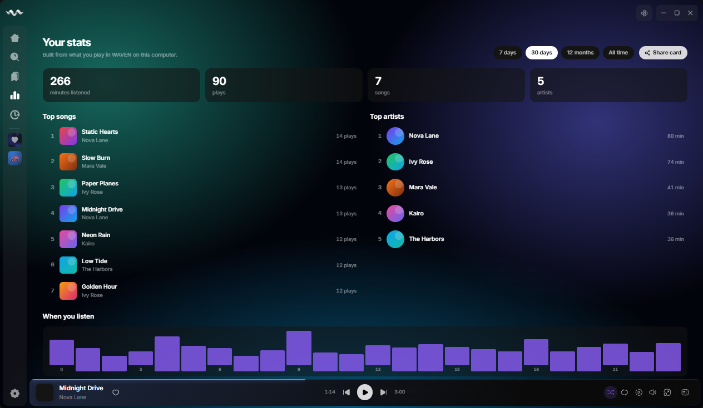
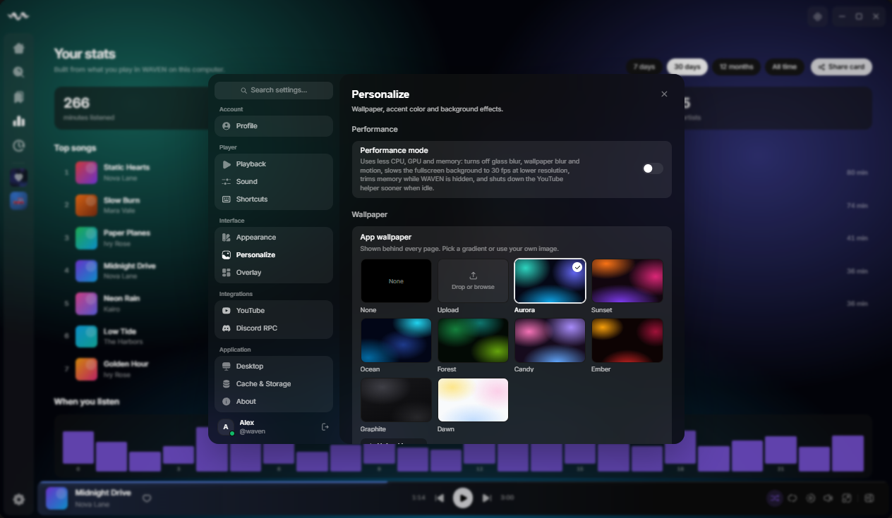
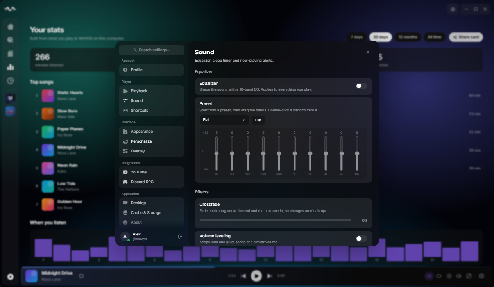

<p align="center">
  
</p>

<h1 align="center">WAVEN</h1>

<p align="center">
  <b>A free desktop music player. No account, no sign-in: everything stays on your PC.</b><br>
  Search any song, build playlists, synced lyrics, wallpapers, themes, an equalizer, listening stats and more.
</p>

<p align="center">
  <a href="https://github.com/sorinisthedev/Waven-liner-mod/releases/latest/download/WAVEN-Setup.exe"></a>
</p>

<p align="center">
  
  
</p>

<p align="center">
  
</p>

> **WAVEN is an unofficial, personal build based on [Liner](https://github.com/tryliner/desktop).** It is not made by, endorsed by or affiliated with the Liner team. WAVEN doesn't use Liner's servers: music comes from YouTube Music and SoundCloud, lyrics from [LRCLIB](https://lrclib.net), and your library is saved on your own PC.

## Install

1. **[Download WAVEN-Setup.exe](https://github.com/sorinisthedev/Waven-liner-mod/releases/latest/download/WAVEN-Setup.exe)** and run it.
2. Open WAVEN from the Start menu and start listening. There's nothing to sign up for.
3. Coming from Liner 2.0? WAVEN replaces it, keeps your settings, and copies your Liner likes and playlists to your PC the first time it opens.

> Windows may say "Windows protected your PC" because the installer isn't code-signed. Click **More info → Run anyway**.

## What you get

- **No account**: likes, playlists, saved albums and artists, and your history are stored on your PC. Back them up to a file from Settings.
- **Search and play anything** from YouTube Music and SoundCloud, with albums, artists, song radio, daily mixes and the weekly charts.
- **Your own music files**: add folders from your PC and play your MP3, FLAC, M4A, WAV, AIFF and OGG files with their covers, next to everything else.
- **Offline downloads**: download any playlist or album and play it with no internet.
- **Automatic updates**: WAVEN checks this page for new versions and installs them for you.
- **Discord status**: shows the song you're playing with its cover, the WAVEN logo, and Listen on WAVEN / Download WAVEN buttons.
- **Make it yours**: profile picture, app wallpapers (gradients or your own image), accent colors, app and lyrics fonts, and a custom theme builder with import and export.
- **Hi-Fi**: a quality badge on every song, Best / Balanced / Data saver streaming, an output device picker and Pure mode for untouched FLAC and WAV playback.
- **Sound**: 10-band equalizer with presets, crossfade, volume leveling, karaoke mode, a visualizer, a sleep timer and a wake-up alarm.
- **Your stats**: minutes listened, top songs and artists, when you listen, a full play history and a shareable Wrapped-style card.
- **Import playlists** from Spotify, YouTube, Apple Music, Deezer and SoundCloud by pasting a link.
- **Share playlists**: send a link and friends add the whole playlist to their WAVEN in one click.
- **Faster to use**: a Ctrl+K command palette, a `?` shortcut sheet, pinned playlists in the sidebar and custom playlist icons.
- **Performance mode**: one click turns off blur and motion to cut CPU, GPU and memory use.
- **Desktop extras**: close to tray, start with Windows, desktop now-playing alerts and settings backup and restore.

<p align="center">
  
  
</p>

New versions are posted on the [Releases](https://github.com/sorinisthedev/Waven-liner-mod/releases) page.

## Recent changes

**1.1.6: Hi-Fi pack**
- **Quality badge** next to the song title shows what's playing, like `OPUS 160` or a gold `FLAC 24/96` for lossless files
- **Streaming quality**: Best, Balanced or Data saver (Settings → Sound)
- **Output device**: send WAVEN to specific headphones, speakers or a DAC without changing the Windows default
- **Pure mode**: turns off every effect so audio goes straight to your speakers untouched
- **AIFF files** now play from your music folders (along with MP3, FLAC, M4A, WAV and OGG)
- Fixed updates failing with a "checksum mismatch" error

**1.1.5**
- **Import playlists** from Spotify, YouTube, Apple Music, Deezer and SoundCloud: press **Import** in the Library and paste the link. WAVEN finds every song and builds the playlist for you
- The same Import window opens WAVEN playlist files

**1.1.4**
- **Share playlists**: press Share on any playlist (or your liked songs) and send the link. Friends click it, press **Add to WAVEN**, and the playlist lands in their library with every song. No account or server needed
- Very big playlists can be saved as a small `.wavenplaylist` file instead; friends add it with **Import** in the Library
- The share page shows the playlist name, song count and cover, with a link to play it on YouTube if they don't have WAVEN yet

**1.1.3**
- Much lower CPU use when idle (about 10% down to under 1%): the lyrics tracker only runs while music plays
- Uses less memory: the floating overlay player only loads the first time you open it

**1.1.2**
- Cleaner, minimal home page: a simple greeting with the date, plain section titles, artwork-only mix covers, no color glow
- Lower CPU use: crossfade and sleep timer checks only run while you're using them

**1.1.1**
- Discord status buttons: **Listen on WAVEN** (opens the song in WAVEN for your friends) and **Download WAVEN**
- WAVEN links use `waven://`, so they never open Liner or other Liner mods

**1.1.0**
- **Automatic updates** from this page
- **Your own music files**: add folders from your PC and play MP3, FLAC, M4A, WAV and OGG
- **Offline downloads** for playlists and albums
- Discord status shows your song, its cover and the WAVEN logo; fixed Discord thinking WAVEN was the game "Waven"

**1.0.1**
- Fixed liked songs and playlists not showing without an account
- Change a playlist's icon from the playlist page or by right-clicking it
- Liner 2.0 settings, wallpaper and library carry over properly

**1.0**
- **No account**: no sign-in, everything is saved on your PC, and Liner's servers aren't used
- Music from YouTube Music and SoundCloud, lyrics from LRCLIB
- New name and wave logo, redesigned player bar and overlay

### Everything changed from Liner
- **No account, no Liner servers**: likes, playlists, saved albums and artists, history and your profile live on your PC
- **Music**: your own music files, offline downloads, daily mixes from your listening, the weekly charts
- **Hi-Fi**: a quality badge on every song, Best / Balanced / Data saver streaming, an output device picker and Pure mode for untouched FLAC and WAV playback.
- **Sound**: 10-band equalizer with presets, crossfade, volume leveling, karaoke mode, visualizer, sleep timer, wake-up alarm, now-playing notifications
- **Make it yours**: profile picture, wallpapers, accent colors, custom theme builder, app and lyrics fonts, playlist icons, pinned playlists
- **Stats**: listening stats, a Wrapped-style card and a full play history
- **Faster to use**: Ctrl+K command palette, `?` shortcut sheet, close to tray, start with Windows, settings backup and restore
- **Performance**: a performance mode button, plus background helpers that only run when needed
- **Updates and sharing**: automatic updates, a Discord status with WAVEN buttons, share links that open in WAVEN, playlist sharing by link or file
- **Look**: WAVEN name and logo, redesigned player bar, overlay and home page

## For developers

WAVEN is an Electron + React app. Requires Node.js 20 or newer.

```bash
npx -y pnpm@10 install
npx -y pnpm@10 dev
```

Build the Windows installer with `npx electron-builder --win --publish never` after `npx tsc -b && npx vite build`; it lands in `release/WAVEN-Setup.exe`. What changed compared to Liner is listed in [LINER2_CHANGES.md](LINER2_CHANGES.md).

## License

Based on [Liner](https://github.com/tryliner/desktop) and distributed under the **Liner Source-Available & Non-Commercial Contribution License**. See [LICENSE](LICENSE). Personal, non-commercial use only.
